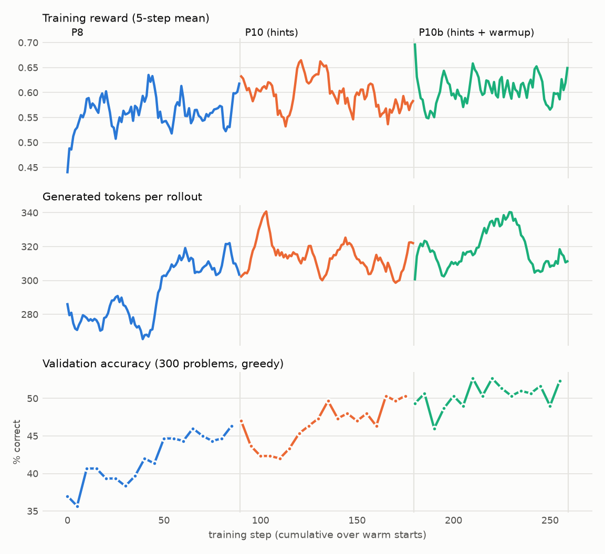

# REPORT.md: Emergent Reasoning via RL and Programmatic Self-Correction

Full experiment log: [EXPERIMENTS.md](EXPERIMENTS.md). Verification evidence: [VERIFICATION.md](VERIFICATION.md).

## 1. Summary

A LoRA (r=16) on **Qwen3-4B-Base**, trained with a custom GRPO loop (native PyTorch, colocated vLLM for rollouts).
Each rollout runs the `<think> / <python> / <output> / <answer>` protocol: `<output>` is real sandbox stdout,
injected mid-generation and masked out of the loss.

- **Result:** the best policy, **P10b s80**, solves **52.8%** of a fresh 1,000-problem holdout (Pass@1, greedy). The holdout was generated after model selection and evaluated once. The previous best scored 47.9% on it (p = 0.0002).
  - On a second fresh holdout it scores 51.3%; on the original test set, 52.7%.
  - The base model scores **0%** zero-shot and **11.3%** with the same few-shot format demo.
  - **The holdout is the headline number.** The test set was reused across lineage decisions (P10 s90 was chosen partly on it) and run on 6+ models, so its numbers are slightly optimistic.
- **Model choice:** gemma-2-2b (the SPEC example) was replaced after a measured comparison. It reached about 2% Pass@1 with the format demo, against about 15% for Qwen3-4B-Base (EXPERIMENTS §2.4).

| Test set, 1,000 problems (SPEC §D) | Base, zero-shot | Base, few-shot | P8 s90 | P10 s90 | **P10b s80** |
|---|---|---|---|---|---|
| Pass@1 | 0.0% | 11.3% | 47.8% | 49.4% | **52.7%** |
| Easy / medium / hard (400 / 300 / 300) | 0 / 0 / 0 | 85 / 23 / 5 | 321 / 97 / 61 | 328 / 105 / 61 | **331 / 116 / 80** |
| Format compliance | 63.4% | 17.6% | 99.9% | 99.8% | 99.7% |
| Generated tokens per answer (own tokens) | 293 | 612 | 296 | 306 | 302 |
| Hit the 768-token cap | 17.9% | 82.3% | 0.1% | 0.2% | 0.3% |
| First check all False → retried → solved | 0 / 18 | 8 / 640 (1.3%) | 73 / 588 (12.4%) | 71 / 569 (12.5%) | 67 / 530 (12.6%) |

**How to read the metrics** (`verification/report_metrics.py`, from the eval dumps):
- **Zero-shot base:** "compliant" but useless. It writes the target number as its answer.
- **Few-shot base:** mostly runs to the 768-token cap.
- **Token length:** the RL policy's answers are *shorter* than the few-shot base's (302 vs 612), not longer. Its length is spent on checks, not rambling.
- **Self-correction:** after a first check in which every candidate printed False, P10b recovers in 12.6% of cases, against 1.3% for the base.

**Statistics:**
- Paired exact McNemar tests: P10b vs P8, p = 0.0005; vs P10 (same run), p = 0.009. P10 vs P8 alone was not significant on test (p = 0.07).
- **What these p-values cover:** they compare two *checkpoints* on a fixed problem set. They don't include run-to-run variance, so they don't show that one *recipe* beats another. A P10b replicate with a different seed and from-scratch seed replays are running to measure that spread. Per-tier p-values are descriptive only (uncorrected).
- Checkpoints were chosen on a 300-problem validation split, never on test or holdout.

## 2. Learning dynamics



*Reward, generated tokens per rollout, and in-run validation accuracy for the lineage P8 → P10 → P10b
(`verification/plot_learning_curves.py`). Each phase warm-starts from the previous phase's chosen checkpoint.
P7 (base → 36% val in 40 steps) is not drawn: its per-step log was not kept.*

- **P8** (the "check several candidates in one `<python>` block" prompt) carried validation accuracy from 37% to 46%.
  - Reward rose 0.44 → 0.60, and length grew 275 → 320 tokens as checks got wider.
- **P10 (hinted rollouts, QuestA-style):** a group where all 8 samples fail is resampled with "Hint: one solution contains X". The hint covers ½, then ¼, then none of the solution.
  - Validation first *dropped* (47 → 42%) while hints dominated, then climbed to 50% once hints faded.
- **P10b:** a second, shorter hint cycle with a 5-step LR warmup. There was no early dip, and validation sat at 50–53%.
- **Hint ablation:** the same 80 steps *without* hints did as well, at 518 vs 513 on a second fresh holdout (p = 0.77). The P10 → P10b gain (+42 to +49 on two holdouts) came from **training longer, not from the hints**. A third hint cycle (P10c, 525) adds nothing significant. There is no evidence in this lineage that hinted resampling helps this task (EXPERIMENTS §2.7m).
  - Length rises while hints are on (longer hinted prompts lead to longer checks), then falls back to about 310 tokens when they stop.
- **Health signals:** KL to the base model grows slowly (0.07 → 0.12 across P10b). Clip fraction is about 0.003. No run hit the length cap.
  - The adaptive KL coefficient sits at its floor (0.001) for most steps, so the KL penalty is in practice inactive (about 1e-4 per token). KL is a monitor here, not a regulator.
- **Training reward is a poor progress signal here.** The signal-based curriculum keeps about half of each batch on hard problems, so train accuracy stays flat (0.35–0.55) while validation improves. Every decision used validation.
- **Validation noise:** "greedy" vLLM evaluation is not reproducible (batched LoRA kernels), giving ±7 problems on 300. Final choices therefore used 3 separate validation passes and their mean (VERIFICATION §19).

## 3. Emergent backtracking (P10b s80, test set, verbatim)

**How much is emergent.** Retrying is *prompted*: the instruction line and the few-shot demo show a second check after a failure. Even the base model retries after an all-False first check in 89% of cases, and RL raises that to 100% (530/531). What RL changed is the *quality* of checks and retries: the first check succeeds more often, and retries recover 12.6% of the time against 1.3% for the base.

All 67 recoveries on the test set follow the same pattern. A full first check fails, the model states this and proposes new candidates, and it answers with the one that printed True. Medium, 75 2 8 4 5 → 391:

```
<python> for res in (75 * 5 + 4 * 8 + 2, 75 * 5 + 8 * 4 + 2, 75 * 5 + 2 * 8 + 4, 75 * 8 - 2 * 4 - 5): print(res == 391, res)
<output> False 409 / False 409 / False 395 / False 587
<think> Candidate expressions didn't work. Let's try different combinations: 75 * 5 + 4 + 2 * 8; 75 * 5 + 8 + 2 * 4; 75 * 4 + 8 * 5 + 2.
<output> False 395 / True 391 / False 342
<answer> 75 * 5 + 8 + 2 * 4
```

- **Using the feedback:** the miss of 395 (4 too high) is fixed by moving the ×2 from 8 to 4, a change of exactly −4.
- **Hard case:** 6 8 1 10 4 9 → 132. The first round produced 180/190/288/120. The second round added `4 * (10 + 9 + 8 + 6)`, which printed True and became the answer.
- **Limits:** many retries still sample new candidates without clearly using the printed values. The strict recovery rate (12.6%) is the honest number; most of the gain since P8 comes from first checks that succeed more often.

## 4. Compute bottlenecks and mitigations

| Bottleneck | Mitigation | Effect |
|---|---|---|
| One-sequence-at-a-time generation with tool calls | Batched rollout engine with per-sequence tool interleave | 7.4× faster, identical metrics |
| HF SDPA with GQA copies the KV cache 4× per step (soos, ROCm) | `attention_gqa.py` (grouped SDPA without repeat) plus merged-LoRA generation | About 10× faster generation on soos |
| Generation dominates GRPO time | Colocated **vLLM** with sleep mode: weights offloaded and KV dropped during the backward pass | 16×8 step: 5 min on soos → 39 s on an RTX PRO 6000; 64×8 step ≈ 2.3 min |
| Large vocabulary in the log-prob pass | Vocab-chunked log-probs; no `(B, T, V)` fp32 tensor | Fits in memory without gradient checkpointing |
| Sampler/trainer log-prob mismatch (up to 0.43 nats) | Truncated importance sampling (cap 2), logged every step | `gen_logp_dev` monitored |
| Spot preemption, single-GPU quota | Atomic COMMIT checkpoints to GCS every 2 steps, auto-resume, cost guard, log sync, chained runs that power off when done | All runs resumable; no idle GPU after a chain |

**Cost** (GPU-hours from the bucket's segment start to the final checkpoint, RTX PRO 6000 spot, about $2/h):
- P7 1.1 h, P8 5.5 h (including the extension), P9 3.3 h (negative), P10 3.8 h, P10b 3.5 h.
- About 17 GPU-hours, roughly $35, plus the soos pilots (P1–P6) at no charge.

## 5. Reward exploitation and mitigations

Reward: `R = R_correct + R_exec + R_format − λ·len`, with λ applied only beyond 512 tokens.

**The real hack.** In the 8×8 pilots, accuracy was about 5%, so most groups had no correct sample. A wrong but well-formed answer still earned exec + format credit, and GRPO learned to answer *without* retrying.
- **Fix 1:** a final answer whose own check printed False ("contradicted") now gets no shaping credit.
- **Fix 2:** an answer using numbers that weren't given ("invalid literals") gets none either.
- **Effect:** `contradicted` fell from 0.23 (base) to 0.04–0.06.
  - **Retries:** after an all-False first check, retrying went from 89% (base) to 100% (P10b, 530/531 on test).
  - The training-time `retry_after_false` (0.5–0.7 in P10b) undercounts: it treats a multi-candidate check with any False as failed. A strict version is logged from 2026-11-06.

**Other safeguards:**
- **Verifier:** `R_correct` is model-independent (AST plus exact fractions, numbers used at most once).
- **Exec credit** needs code that ran cleanly and combines at least 2 input numbers, which blocks `print(target)` and dummy code.
- **Hallucinated `<output>`:** writing one ends the rollout with no credit (rate 0.0002 at the end of P10b).
- **Hack suite:** 20 hand-built hacks all score below honest answers (`verification/test_reward_hacks.py`).
- **Auto-stop guards:** training stops itself with a checkpoint if `contradicted` > 0.6 or `frac_max_length` > 0.4 over 5 steps. Neither ever tripped.

**Evaluation hygiene:**
- Hints are training-only; the evaluation code never passes them.
- The holdout sets are frozen by sha256, disjoint from all other data, absent from the training VM image, and checked by tests.

## 6. What's next (in progress)

- **Ablation:** P10b with hints off, everything else identical. It answers whether P10b's gain came from the hints or simply from 80 more steps.
- **P10c:** a third hint cycle from P10b s80.
- **Evaluation:** both are chosen on 3-pass validation and then evaluated once on a fresh holdout (`data/holdout2.jsonl`).
