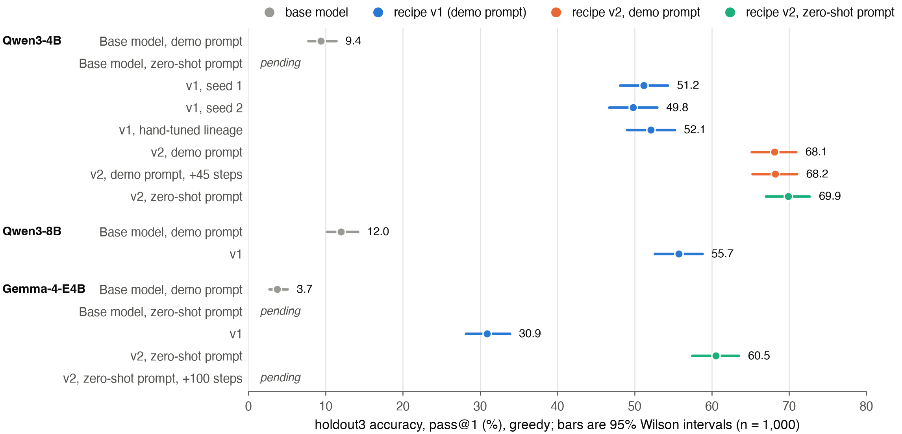
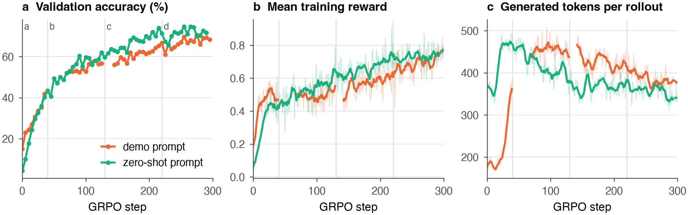
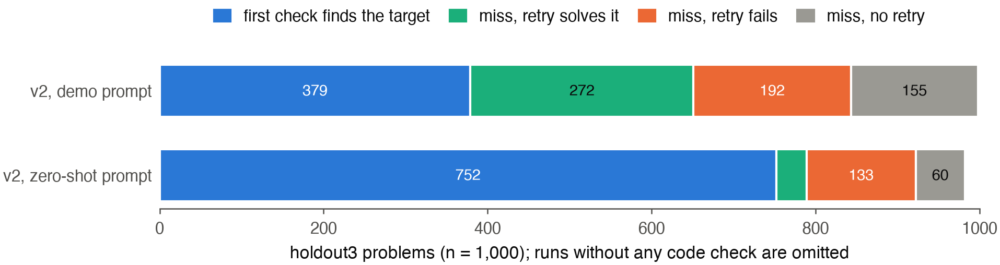

# Tool-use reasoning from a tool description: GRPO + LoRA on Countdown

## Summary

We train LoRA adapters (r = 16) on base models with GRPO to play Countdown. The policy reasons in `<think>`, can run
`<python>`, sees the real sandbox stdout in `<output>`, and answers in `<answer>`. Our main finding is that
**no demonstration is needed**. With a zero-shot prompt that only says the tool exists, Qwen3-4B-Base goes from
0% to **69.9%** pass@1 on a fresh 1,000-problem holdout. With a one-example demo prompt and an otherwise
identical run, it reaches 68.1% (paired McNemar p = 0.23). The zero-shot policy is better on the hardest tier
(181 vs 153 of 300). Earlier we had concluded that zero-shot RL was impossible for this model, because the base
model scored 0% zero-shot. That was a prompt problem: our original zero-shot prompt showed the tag skeleton but
never said that code is executed. Describing the tool raises the share of training problems with at least one
correct sample out of eight from 3/256 to 58/256. That is enough gradient signal for GRPO to start. The same
recipe and prompt take Gemma-4-E4B from near zero to 60.5%, but Gemma learns to solve the problem in `<think>`
and uses the tool only as a last resort.

All holdout numbers come from `data/holdout3.jsonl`. It was generated after every training and selection decision,
is disjoint from all other data, and each checkpoint was evaluated on it exactly once (greedy decoding, 768 new
tokens, two code rounds). Every number below can be recomputed from `results/`.

## Setup

**Data.** 10,000 training and 1,000 test problems from an exact solver, so every problem is solvable. There are
three tiers: easy (3–4 numbers, two-digit target), medium (5 numbers, three-digit target) and hard (6 numbers,
three-digit target), in proportions 40/30/30. 300 training problems are held out for in-run validation. Three further 1,000-problem holdout
sets were generated later, one per round of model selection.

**Sandbox.** Code is parsed and checked against an AST whitelist: arithmetic, comparisons, assignments, loops,
and calls to `print`, `range` and `len` only. There are no imports, attribute access or I/O. It then runs with the
same three builtins in a persistent stdlib-only worker process (`python -I -S`). The worker is killed and respawned
after 50 ms, and its stdout is cut to 200 characters. A separate process rather than a thread means a runaway loop
or a memory bomb cannot hurt the trainer.

**Reward and objective.** The reward is R = R_correct (1.0) + R_exec (0.1) + R_format (0.1) − 0.001 · max(0,
len − 512). R_correct uses an AST + `Fraction` verifier that enforces the number multiset. GRPO uses G = 8 rollouts
per prompt and 64 prompts per step, with group-normalised advantages and an asymmetric clip (0.2 / 0.28).
Truncated importance weights correct the mismatch between the vLLM sampler and the trainer. Tokens injected inside
`<output>` get label −100. The model is fed exactly the token ids it is trained on, so no retokenisation drift
occurs at the boundaries. A curriculum samples each tier in proportion to the fraction of its recent groups that
had mixed outcomes (0 < #correct < G), which is where the gradient comes from.

**Recipes.** *v1* adds an adaptive KL penalty, resampling all-fail groups with a partial-solution hint, and shaping
credit on groups with no correct answer. *v2* removes all three and adds gradient clipping at 1.0. Every run follows
the same four-phase schedule of 40/90/90/80 steps (300 in total). Each phase warm-starts from the final step of the
previous one, so no checkpoint is picked by hand.

## Results



*Figure 1. holdout3 pass@1 for every final checkpoint, with 95% Wilson intervals. Each row was evaluated once.
"Pending" rows are queued evaluations.*

**v2 beats v1 by a wide margin.** On holdout3, three v1 lineages of Qwen3-4B land at 49.8–52.1%. A v2 run with the
same seed and schedule reaches 68.1% (p < 10⁻²⁷). Qwen3-8B under v1 (55.7%) is beaten by Qwen3-4B under v2. We
attribute most of the gain to not training on groups that contain no correct answer. Under v1, those groups still
pay format and execution credit, and the gradient they produce favours well-formed wrong answers over retries.
Continuing the v2 demo run for 45 more steps changes nothing (68.2%).

**A demonstration is not needed.** The zero-shot arm starts 11 points behind the demo arm on validation and
catches up within about 20 steps (Fig. 2a). After that it stays at or above the demo arm, ending at 69.9% vs 68.1%
on holdout3. The pre-registered criterion for "demo not needed" was 661 or more correct (within 2 pp of the demo
run), and the arm met it. We claim parity, not superiority: the difference is +18 problems on 109 vs 91 discordant
pairs. Evaluated with the demo prompt instead of its own, the zero-shot policy drops to 30.9%. Each policy is
specific to the prompt it was trained with.

**Transfer to other models.** With the zero-shot prompt and v2, Gemma-4-E4B reaches 60.5% (v1 with the demo prompt:
30.9%, p < 10⁻⁶⁰). It runs code on only 35% of problems, and its first printed value never equals the target. It
enumerates combinations in `<think>` and calls `<python>` only when it is stuck, which mostly happens on problems it
then fails. A 100-step continuation is running: *pending*. Gemma-4-E2B gives almost no GRPO signal at the start
(1/256 problems with a correct sample, against 58/256 for Qwen3-4B). A 50-step zero-shot run and a matched 50-step
demo-prompt run test whether training can start anyway: *pending (zero-shot run at step 28: validation 2%, 13 of
64 groups with signal)*. gemma-2-2b, the model named in the SPEC, gives 0/256, and with the demo prompt it scored
about 2% against about 15% for Qwen3-4B. We used Qwen3-4B for that reason.



*Figure 2. Qwen3-4B, recipe v2, seed 2: demo prompt vs zero-shot prompt over the four phases (boundaries at 40, 130
and 220). (a) Greedy accuracy on the 300 validation problems, every 5 steps. (b) Mean training reward. (c) Mean
generated tokens per rollout, excluding injected output. Faint lines are per-step values; bold lines are 7-step
moving averages. Gaps are steps missing from the logs (see Limitations).*

**Learning dynamics.** Reward and validation accuracy rise together and are still rising slowly at step 300. The
training reward understates progress, because the curriculum shifts sampling toward hard problems as easy ones
saturate. Length moves in opposite directions for the two arms (Fig. 2c). The demo arm jumps from about 180 to 460
tokens when its prompt switches at step 40 to checking several candidates per code block. The zero-shot arm
reaches about 470 tokens in phase a without any instruction to do so, then shortens to about 350 as checks become
more targeted. The length penalty did real work here. In phase a, 26% of zero-shot rollouts ran into the
768-token cap, and the penalty beyond 512 tokens pushed that down to 1% by phase d without an explicit length
target. The demo arm peaked at 33% in phase b and ended at 10%.

## Self-correction



*Figure 3. What happens after the first code execution on holdout3. "Finds the target" means the first output
prints `True` or the target value.*

The two policies use the tool differently (Fig. 3). After a miss, both retry about as often (74% vs 75%), but the
demo-trained policy recovers far more often after a retry (59% vs 22%). The zero-shot policy's advantage comes from
missing much less often in the first place (230 vs 619 first checks). It does the arithmetic in `<think>` and uses
the code to confirm. Its retries are real backtracking: the printed value shows that the expression it wrote down
does not match its own reasoning, and it builds a new decomposition. A typical hard case (holdout3, verbatim apart
from whitespace):

```
6 7 2 25 1 8 -> 168
<think> 6 * 28 = 168. 28 can be made from 25 + 7 - 2 = 30 - 2 = 28 ... </think>
<python> print(6 * (25 + 7 - 2)) </python>          <output> 180 </output>
<think> That didn't work, let's try another combination: 8 * 21 = 168. 21 can be made from 7 * 3,
        and 3 can be 6 - 2 - 1 ... </think>
<python> print(8 * (7 * (6 - 2 - 1))) </python>     <output> 168 </output>
<answer> 8 * (7 * (6 - 2 - 1)) </answer>
```

The behaviour depends on the feedback. On the 1,000 test problems, with the HF backend, the v1 hand-tuned policy
scores 51.8% with real outputs (52.7% under vLLM in the table below). It scores 12.8% when `<output>` is blanked and 47.4% when its digits are shuffled, so it reads mostly the
`True`/`False` flag. Allowing it 0, 1 or 2 code rounds gives 17.8%, 47.3% and 51.8%. Sampling 4 attempts at
T = 0.9 gives pass@4 of 65.3% against a mean pass@1 of 49.5%.

## SPEC §D: base model vs RL policy on the 1,000-problem test set

| | Base, zero-shot (`zero`) | Base, zero-shot (`r1zero_tool`) | Base, demo prompt | v1 hand-tuned | v2, demo | v2, zero-shot |
|---|---|---|---|---|---|---|
| Pass@1 | 0.0% | *pending* | 11.3% | 52.7% | 70.0% | *pending* |
| Easy / medium / hard | 0 / 0 / 0 | | 85 / 23 / 5 | 331 / 116 / 80 | 358 / 174 / 168 | |
| Format compliance | 63.4% | | 17.6% | 99.7% | 91.7% | |
| Generated tokens (mean) | 293 | | 612 | 302 | 341 | |
| Hit the 768-token cap | 17.9% | | 82.3% | 0.3% | 8.3% | |
| Solved after a missed first check | 0 / 823 | | 8 / 722 | 67 / 531 | 320 / 608 | |

The test set informed some early v1 decisions, so its numbers are slightly optimistic. Holdout3 is the clean
comparison. The base model's `zero` result is 0% because it writes the target number as its answer.

## Reward exploitation

One real exploit appeared. In early 8×8 pilots, about 5% of rollouts were correct, so most groups had no correct
sample. A wrong but well-formed answer still earned R_exec + R_format, and within four steps the policy stopped
retrying after a failed check (retries on held-out problems fell from 33/43 to 0/41). Three fixes closed it:
- **Contradicted answers:** no shaping credit for a final answer that the model's own executed check had already
  shown to be wrong.
- **Invalid numbers:** no shaping credit for an answer that uses numbers it was not given.
- **v2:** no training at all on groups without a correct answer.

Other guards:
- R_exec requires clean execution of an expression that combines at least two input numbers, which blocks
  `print(target)`.
- A fabricated `<output>` block ends the rollout immediately and earns no shaping credit.
- Training stops itself if contradicted answers exceed 60% or capped rollouts exceed 40% over five steps.
- A suite of 20 hand-built hacks (`tests/independent/test_reward_hacks.py`) checks that each one scores below an
  honest answer.

Hints are training-only. The holdout files never reach the training machines, and tests check this.

## Compute

| Bottleneck | Mitigation |
|---|---|
| Generation dominates a GRPO step | Colocated vLLM with sleep mode (weights offloaded and KV cache freed during the backward pass). A 64×8 step takes about 2.3 min on one RTX PRO 6000. |
| HF generation on ROCm repeats the KV cache for GQA | Grouped SDPA kernel without the repeat (`rl/attention.py`) and merged-LoRA decoding: about 10× faster evaluation. |
| Large-vocabulary log-probs | Chunked over the vocabulary, so no (B, T, V) fp32 tensor is materialised. |
| Spot preemption | Atomic checkpoints to GCS every two steps, auto-resume, a cost cap per run, and power-off at the end of a lineage. |

All training ran on spot RTX PRO 6000 instances at about $2/h. A full 300-step lineage costs 10–16 GPU-hours. The
zero-shot Qwen3-4B run took 11.9 h (about $24). Everything reported here, including pilots, ablations and
continuations, used 134 GPU-hours (about $270), measured from the checkpoint heartbeats
(`scripts/cost_report.py`). Evaluations ran on a local workstation at no cost.

## Deviations from the SPEC and limitations

- **Model:** Qwen3-4B-Base instead of gemma-2-2b. See Results; Gemma-4 results are reported alongside.
- **No SFT cold start:** programmatic SFT traces were tried early and did not beat the base model. The prompt
  and the signal curriculum replace them, and the zero-shot result shows that no cold start is needed once the
  prompt describes the tool.
- **Sandbox in a separate process,** not in-process: this gives stronger isolation.
- **Seeds:** the main comparison rests on one seed per arm. The three v1 Qwen3-4B lineages put the run-to-run
  spread at about 2 pp on holdout3 (49.8–52.1%). That is far smaller than the v1→v2 gap but about the size of the
zero-shot vs demo gap.
- **Missing log steps:** a bug in resuming after preemption overwrote the start of four training logs: v2 demo
  phase b steps 0–29 and phase c steps 0–11; v2 seed 1 phase b steps 0–13; zero-shot phase d steps 74–75.
  Checkpoints and evaluations were not affected, and the bug is fixed.
